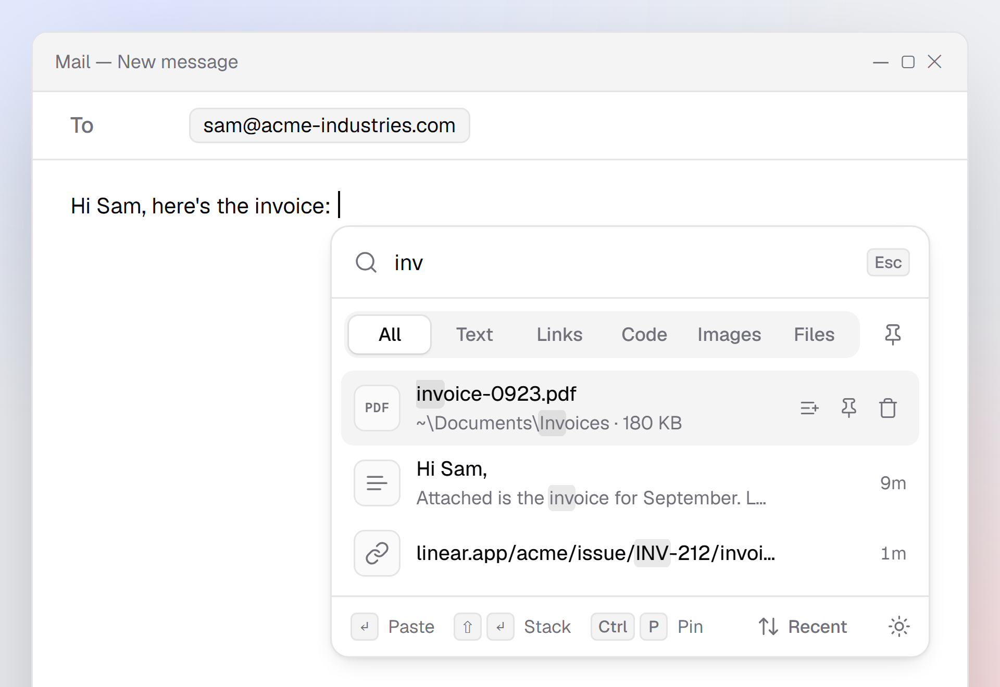
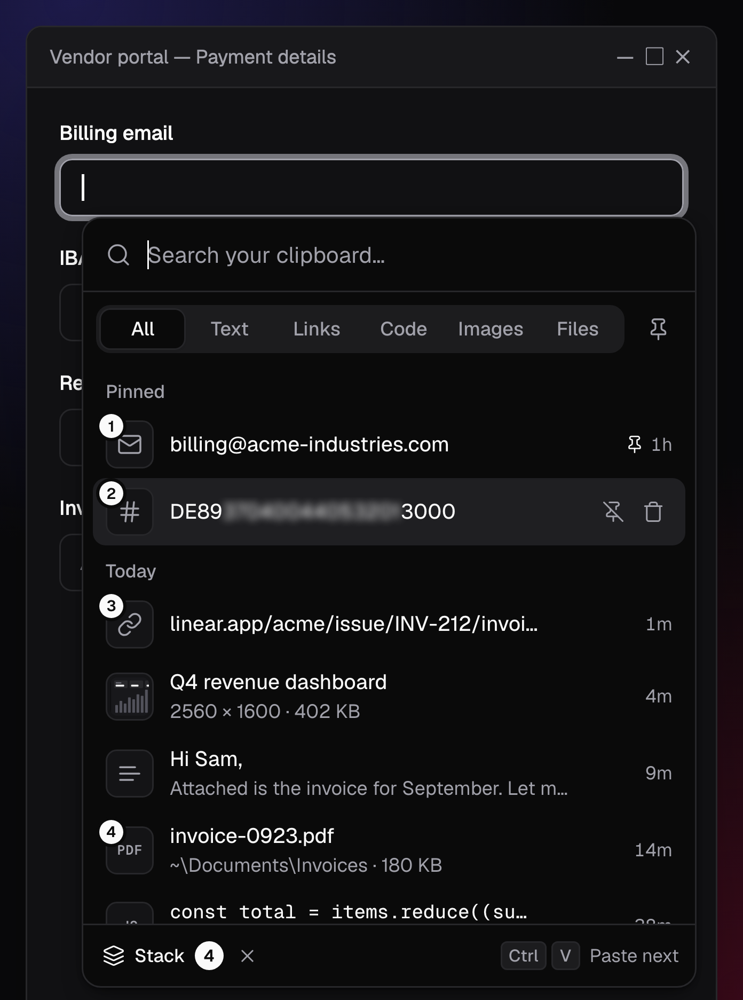
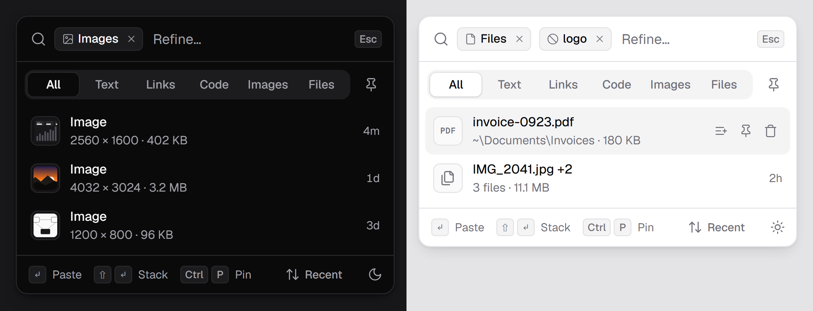

# stash

A tiny clipboard history for Windows and macOS. Press a hotkey and a small
list pops up right at your text caret — pick a clip with the keyboard and it's
pasted. Text, links, code, images and files all go in. Text inside copied
images is recognized locally, so screenshots are searchable too. Everything
stays on your computer.

On macOS, read `Ctrl` as `⌘` (Command) everywhere below, except in the hotkey,
which is `Ctrl+Option+V` (`⌃⌥V`) on both systems.

<p align="center"></p>

## Paste stack



Collect clips in the order you need them, then paste them one after another
with plain `Ctrl+V` (`⌘V` on macOS), in any app. Made for forms: email, Tab,
Ctrl+V, IBAN, Tab, Ctrl+V…

1. In the popup, `Ctrl`-click a clip (`⌘`-click on macOS) to add it. It gets
   a number, and the footer becomes the stack bar. Clip 1 goes straight onto
   the clipboard. `Ctrl`-click it again to take it out; a plain click pastes
   that clip and ends the stack.
2. Close the popup and press `Ctrl+V`: it pastes clip 1. The next `Ctrl+V`
   pastes clip 2, then clip 3, and so on. (`Enter` in the popup pastes the
   next clip too.)
3. It ends after the last clip, when you copy something yourself, or with the
   × in the stack bar (open the popup to see what's next).

How it works: the stack lives in the stash process, not the popup, so it
keeps running with the popup closed. stash never intercepts or delays your
paste. While a stack runs it watches the keyboard (a low-level keyboard hook on
Windows, an event tap on macOS), and when you let go of V after a `Ctrl+V` /
`⌘V` it puts the next clip on the clipboard. Pastes stash sends itself are
tagged and skipped, and the watcher stops as soon as the stack ends. On macOS
this needs Accessibility access (see below).

<br clear="right">

## Use

| key | does |
| --- | --- |
| `Ctrl+Alt+V` | open / close the popup (configurable) |
| type | search |
| `↑` `↓` · `Ctrl+J/K` | move |
| `Enter` | paste (with a stack: paste its next clip) |
| `Ctrl+1`…`9` | paste the numbered row |
| `Ctrl+Enter` | copy only, don't paste |
| `Ctrl`+click | add to / remove from the paste stack |
| `Ctrl+P` | pin / unpin (pinned clips are never pruned) |
| `Ctrl+D` · `Del` (empty search) | delete (macOS also `⌘⌫`) |
| `Tab` / `Shift+Tab` | cycle tabs: all · text · links · code · images · files |
| `Ctrl+S` | cycle sort: recent · frequent · a–z · largest |
| `Ctrl+T` | theme: auto · dark · light |
| `Ctrl+,` | settings |
| `Backspace` (empty search) | remove the last filter chip |
| `Esc` | clear search, then close |

### Search

Plain words are fuzzy (`ghb` finds *GitHub*), and every word must match.

| syntax | meaning |
| --- | --- |
| `'word` | exact substring |
| `^word` | starts with |
| `!word` | exclude clips containing it |
| `@link` `@code` `@path` `@color` `@number` `@email` `@text` `@image` `@file` | only that kind |
| `@pin` | only pinned |
| `@hour` `@today` `@week` | only recent |

A word with a capital letter matches case-sensitively. Filter words turn into
chips as you finish them (type a space); click a chip's × to drop it.
Combine freely: `@code !test fetch`.

Text that stash recognized inside a copied image is searched along with the
clip, and the first line is shown in the image's row. OCR runs on your machine
through the OCR engine built into Windows or macOS (Vision); set `ocr_images`
to `false` in the config to turn it off.

<p align="center"></p>

### Secrets

Secrets in the list are blurred, so they don't show at a glance when someone
looks over your shoulder or you share your screen. Hover the blur to read it.
Just enough stays visible to tell what the clip is and which one:

| looks like | stays visible | example |
| --- | --- | --- |
| IBAN (checksum valid) | country, check digits, last 4 | `DE89░░░░░░░░░░3000` |
| card number (Luhn valid) | last 4 | `░░░░ ░░░░ ░░░░ 1111` |
| API token with a known prefix (`sk-`, `ghp_`, `AKIA`, `xoxb-`, JWT `eyJ`…) | prefix, last 4 | `ghp_░░░░░░░░2345` |
| `password=`, `api_key:`, `"client_secret":`, `?access_token=`… | the name | `DB_PASSWORD=░░░░░░` |
| password in a URL | everything else | `postgres://app:░░░░@db:5432` |
| `Bearer` / `Basic` header value | the scheme | `Bearer ░░░░░░░░` |
| private key (`-----BEGIN … PRIVATE KEY-----`) | the BEGIN line | |

This only changes how the list shows them; pasting gives you the clip as it
was copied. It also works on text recognized in screenshots.

### Image files and SVG

Copied image files (SVG, PNG, JPEG, GIF, WebP, BMP, ICO, AVIF, and HEIC on
macOS) and copied SVG markup, as Figma and icon sites put it on the clipboard,
show a thumbnail instead of a file or code icon, with their size in pixels.
Hold `Shift` over the row for a larger preview. Transparent artwork sits on a
checkerboard, so black icons stay visible in dark mode.

The thumbnail is drawn the first time the row is shown, from the original
file (up to 20 MB) or markup, and stored at 160 px: as JPEG when the image is
opaque and PNG when it has transparency, usually a few KB. SVG is drawn as an
image, so scripts in it never run. PDFs and videos keep their file icon.

The pin button next to the tabs shows pinned clips only. Hover a row for its
quick actions: open a link in your browser, show a file in Explorer or Finder, copy code
as a fenced block, copy a colour as HEX, RGB or HSL, pin or delete.
Right-click any clip for the same actions in a stash-native menu, or
right-click anywhere else for filters, sort, theme, settings and hide (on
macOS, Ctrl-click works too). The tray icon (menu bar icon on macOS) has: pause
capturing, start with Windows / open at login, clear history (keeps pinned),
settings, quit.

### Settings

The gear in the footer (or `Ctrl+,`) turns the popup into a small settings
page: the shortcut (click it and press a new one), start with Windows / open at
login, theme, pause capturing, what gets captured (images, text in images,
files, macOS screenshots, password-manager copies), how many clips to keep, and
clear history. Changes apply at once and are written to `config.json`. `↑` `↓`
move between rows, `Space` toggles, `Esc` goes back.

### macOS screenshots

Screenshots you take with macOS's own tool (`⌘⇧3`, `⌘⇧4`, `⌘⇧5`) are still
saved as files as usual, and stash also puts each one on the clipboard. So it
lands in your history (with its text recognized) and `⌘V` pastes it right
away. stash follows the save location you pick in the Screenshot app and
recognizes screenshots by the tag macOS gives them, so renamed or localized
files work too. With the floating thumbnail on, macOS saves the file a few
seconds later; turn it off under `⌘⇧5` → Options for instant capture. Set
`capture_screenshots` to `false` in the config to turn this off.

### macOS permissions

stash lives in the menu bar, with no Dock icon. To paste for you, find the text
caret and run a paste stack it needs **Accessibility** access: macOS asks on
first launch; allow stash under System Settings → Privacy & Security →
Accessibility. Without it, stash still records your clipboard and copies the
clip you pick, and you press `⌘V` yourself.

## Config

`config.json` is created on first run in
`%APPDATA%\app.stash.clipboard\` (Windows) or
`~/Library/Application Support/app.stash.clipboard/` (macOS):

```json
{
  "hotkey": "Ctrl+Alt+V",
  "max_items": 2000,
  "max_clip_chars": 100000,
  "ignore_sensitive": true,
  "capture_images": true,
  "capture_files": true,
  "ocr_images": true,
  "max_image_megapixels": 40,
  "capture_screenshots": true
}
```

Most of it can be changed on the settings page; the size limits only here.
Edits apply as soon as you save the file, no restart needed. If the file or
the hotkey is invalid, the previous settings stay active.

History lives next to it in `clips.db` (SQLite, not encrypted). Images are
stored in full as PNG, with a small preview for the list; recognized text is
stored next to them. For copied files stash keeps the paths, not the files
(plus a small thumbnail for images): pasting puts the same files back on the
clipboard, so a moved or deleted file won't paste. With
`ignore_sensitive`, copies that password managers mark as "exclude from
history" are never stored (on macOS: the nspasteboard.org concealed and
transient types that password managers such as 1Password and KeePassXC set).

## Build

Needs Rust; on Windows 10 also the WebView2 runtime (already on Windows 11),
on macOS the Xcode command line tools.

```sh
cargo install tauri-cli --version "^2" --locked
cd src-tauri
cargo tauri dev      # run
cargo tauri build    # Windows: exe + installer · macOS: stash.app + .dmg (in target/release/bundle)
```

On Windows `target/release/stash.exe` is a single portable file. On macOS
drag `stash.app` to Applications. The build is signed ad hoc but not
notarized, so macOS blocks the first launch: open System Settings → Privacy &
Security and choose Open Anyway. Each new build also has to be allowed under
Accessibility again. Every push to `main` also builds both in GitHub
Actions (artifacts `stash-windows` and `stash-macos`), so you don't need a
local toolchain.

Tests: `node ui/search.test.js`, `node ui/secrets.test.js` and `cd src-tauri && cargo test --lib`.
`ui/index.html` also opens in a plain browser with demo data for UI work;
`docs/showcase.html`, `docs/in-use.html` and `docs/stack.html` are the scenes for the screenshots.

## Known limits

- The popup appears at the caret in apps that expose a system caret (Notepad,
  Word, most native fields; on macOS most Cocoa apps such as TextEdit, Notes,
  Mail). Browsers and Electron apps draw their own caret, so there it appears
  at the mouse pointer instead.
- It can't paste into windows running as administrator unless stash does too,
  and a paste stack doesn't notice pastes made into them.
- A paste stack advances 120 ms after you let go of V. An app that reads the
  clipboard later than that would get the next clip instead.
- Image OCR uses the language packs installed in Windows, or the languages
  Vision supports on macOS (detected automatically on macOS 13+). It handles
  ordinary screenshots and photos of text; very small or stylised text can be
  missed.
- On macOS pasting presses the key in the V position, and the paste stack
  watches that key, so with a Dvorak layout use "Dvorak – QWERTY ⌘".
- macOS has no clipboard change event, so stash checks it 5 times a second
  (a cheap counter read).
- The Windows build was written and compile-checked from a Linux machine; it
  has not been run on a real Windows desktop yet, so expect to tweak placement
  and focus behaviour.

UI font: [Geist](https://github.com/vercel/geist-font) (SIL OFL, `ui/fonts`). Icons: [Lucide](https://lucide.dev) (ISC).
