<picture>
  <source media="(prefers-color-scheme: light)" srcset="docs/hero-light.webp">
  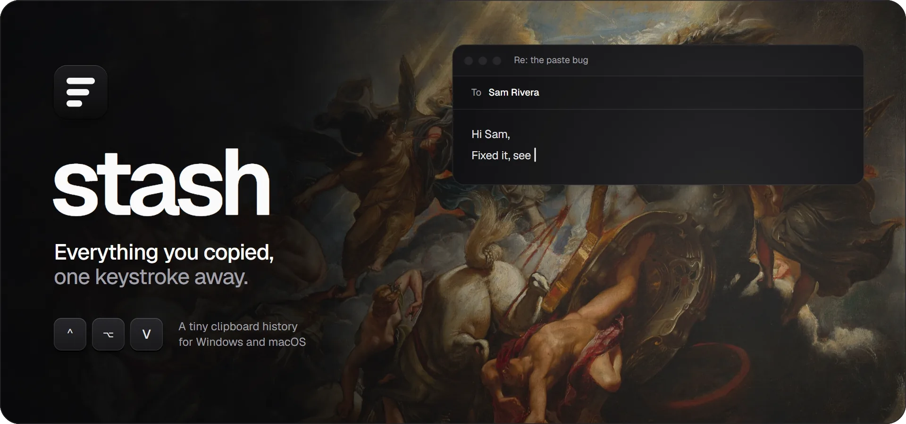
</picture>

<p align="center">
  <b>A tiny clipboard history for Windows and macOS.</b><br>
  Press a hotkey and a small list pops up right at your text caret. Pick a clip with the keyboard and it's pasted.
</p>

<p align="center">
  
  
  
  
  
</p>

<p align="center">
  <a href="#everything-goes-in">Everything goes in</a> ·
  <a href="#paste-stack">Paste stack</a> ·
  <a href="#keys">Keys</a> ·
  <a href="#find-anything">Find anything</a> ·
  <a href="#private-by-default">Private by default</a> ·
  <a href="#build">Build</a>
</p>

<br>

<a id="everything-goes-in"></a>
<picture>
  <source media="(prefers-color-scheme: light)" srcset="docs/title-1-light.webp">
  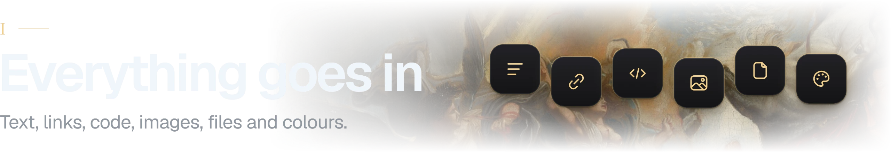
</picture>

<table align="center">
<tr>
<td width="200" align="center"><br><b>Text</b><br><sub>keeps its formatting</sub></td>
<td width="200" align="center"><br><b>Links</b><br><sub>open in your browser</sub></td>
<td width="200" align="center"><br><b>Code</b><br><sub>badged by language</sub></td>
</tr>
<tr>
<td width="200" align="center"><br><b>Images</b><br><sub>their text is searchable</sub></td>
<td width="200" align="center"><br><b>Files</b><br><sub>thumbnails and fonts</sub></td>
<td width="200" align="center"><br><b>Colours</b><br><sub>HEX, RGB or HSL</sub></td>
</tr>
</table>

Everything stays on your computer, encrypted. Text pastes back with the
formatting it was copied with; `Alt+Enter` pastes it plain. Text inside
screenshots is recognized on your machine, so you can search those too.

&nbsp;Hold `Shift` to see an image larger or long text in full. Rows preview
what they can't spell out: image files, SVG markup, data URLs, fonts, colours and
CSS gradients.

&nbsp;Hover a row for quick actions: open a link, show a file in Explorer or
Finder, copy code as a fenced block or a colour as HEX, RGB or HSL. Right-click
for the same in a menu.

&nbsp;macOS screenshots (`⌘⇧3`, `⌘⇧4`, `⌘⇧5`) are still saved as files and
land in the history too, ready to paste.

<br>

<a id="paste-stack"></a>
<picture>
  <source media="(prefers-color-scheme: light)" srcset="docs/title-2-light.webp">
  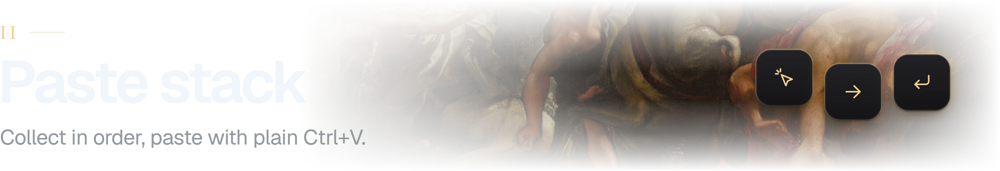
</picture>

<p>
<picture>
  <source media="(prefers-color-scheme: light)" srcset="docs/stack-light.webp">
  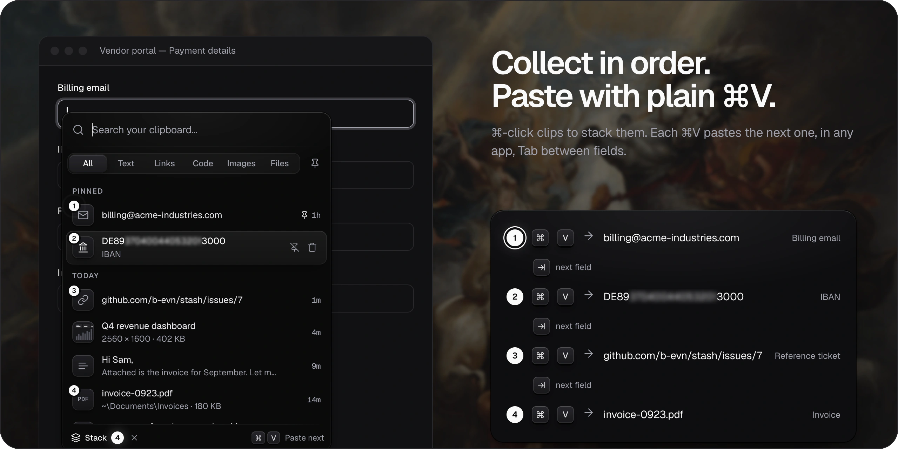
</picture>
</p>

Made for forms. `Ctrl`-click clips in the order you need them, close the popup,
and each plain `Ctrl+V` pastes the next one, in any app: email, Tab, `Ctrl+V`,
IBAN, Tab, `Ctrl+V`…

&nbsp;Stacked clips go in as plain text. The stack ends after its last clip,
when you copy something yourself, or with the × in its bar.

&nbsp;It never holds up your paste: it waits for you to let go of V, then puts
the next clip on the clipboard.

<br>

<a id="keys"></a>
<picture>
  <source media="(prefers-color-scheme: light)" srcset="docs/title-3-light.webp">
  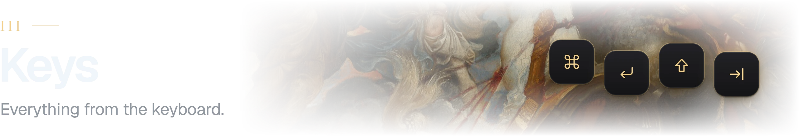
</picture>

<p>
<picture>
  <source media="(prefers-color-scheme: light)" srcset="docs/keys-light.webp">
  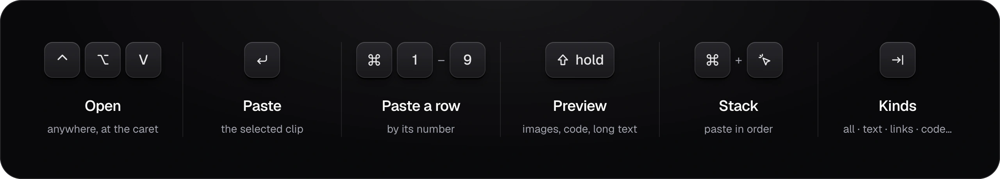
</picture>
</p>

On macOS read `Ctrl` as `⌘` and `Alt` as `⌥`, except in the hotkey, which is
`⌃⌥V` on both.

<details>
<summary>All keys</summary>

| key | does |
| --- | --- |
| `Ctrl+Alt+V` | open / close the popup (configurable) |
| `Enter` | paste |
| `Ctrl+1`…`9` | paste that row |
| `Alt+Enter` | paste as plain text |
| `Ctrl+Enter` | copy without pasting |
| hold `Shift` | preview |
| `Ctrl`+click | add to the paste stack |
| `Ctrl+P` | pin, so it's never pruned |
| `Ctrl+D` | delete |
| `Tab` | cycle kinds |
| `Ctrl+S` | cycle sort: recent · frequent · a–z · largest |
| `Ctrl+T` | dark or light |
| `Ctrl+,` | settings |
| `Esc` | clear the search, then close |

</details>

<br>

<a id="find-anything"></a>
<picture>
  <source media="(prefers-color-scheme: light)" srcset="docs/title-4-light.webp">
  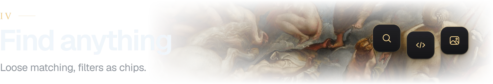
</picture>

<p>
<picture>
  <source media="(prefers-color-scheme: light)" srcset="docs/panels-light.webp">
  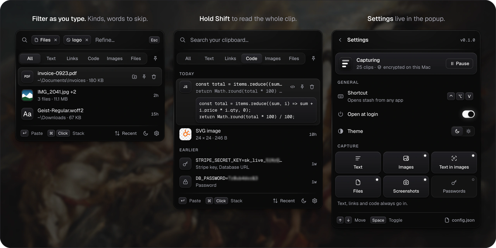
</picture>
</p>

&nbsp;Just type. Words match loosely (`ghb` finds *GitHub*), every word has to
match, and a capital letter makes a word case-sensitive.

| type | to find |
| --- | --- |
| `'word` · `^word` · `!word` | exactly it · starting with it · without it |
| `@code` `@link` `@image` `@file` `@color` `@email` `@number` `@path` `@text` | one kind |
| `@pin` · `@hour` `@today` `@week` | pinned · recent |

&nbsp;Filters turn into chips as you type them. Combine freely: `@code !test fetch`.

&nbsp;The gear in the footer opens the settings: what stash is doing (capturing
or paused, how many clips, whether they're encrypted), the shortcut, start at
login, theme, which kinds get captured, and how many clips to keep. They're saved
to `config.json`, which you can also edit by hand; it applies as soon as you save.

<br>

<a id="private-by-default"></a>
<picture>
  <source media="(prefers-color-scheme: light)" srcset="docs/title-5-light.webp">
  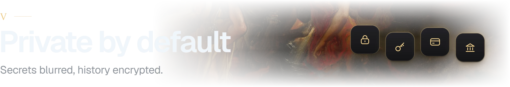
</picture>

<p>
<picture>
  <source media="(prefers-color-scheme: light)" srcset="docs/secrets-light.webp">
  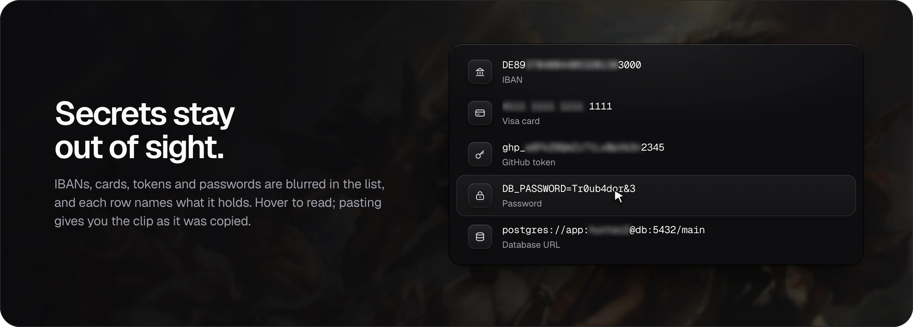
</picture>
</p>

&nbsp;Secrets are blurred in the list, so they stay hidden when you share your
screen: IBANs, card numbers, API tokens, passwords, private keys and URLs with a
password in them. Each row names what it holds, such as *Visa card* or *GitHub
token*; hover to read it. Pasting gives you the clip as it was copied.

&nbsp;The history is encrypted on disk: a [SQLCipher](https://www.zetetic.net/sqlcipher/)
database (AES-256) whose key lives in the macOS Keychain or Windows Credential
Manager, never in a file. Copies and backups of it are unreadable. It guards the
history at rest, not against software running as you.

&nbsp;Password managers are respected. Copies they mark as "exclude from history"
(1Password, KeePassXC…) are never stored.

&nbsp;Nothing leaves your computer. Text in images is recognized by the OCR built
into Windows and macOS. No account, no cloud.

<br>

<a id="build"></a>
<picture>
  <source media="(prefers-color-scheme: light)" srcset="docs/title-6-light.webp">
  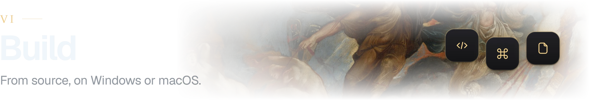
</picture>

Every push to `main` builds both in GitHub Actions (artifacts `stash-windows`
and `stash-macos`), so you don't need a local toolchain. To build it yourself
you need Rust, on Windows also Strawberry Perl (for the OpenSSL that SQLCipher
uses) and on Windows 10 the WebView2 runtime, on macOS the Xcode command line
tools.

```sh
cargo install tauri-cli --version "^2" --locked
# or prebuilt, in seconds: npm install -g @tauri-apps/cli@2, then write `tauri` for `cargo tauri`
cd src-tauri
cargo tauri dev           # run
cargo tauri build         # Windows: portable stash.exe + installer
../scripts/build-mac.sh   # macOS: stash.app + .dmg
```

On macOS drag `stash.app` to Applications. It isn't notarized, so allow the
first launch under System Settings → Privacy & Security → Open Anyway, and give
it **Accessibility** there so it can paste for you (without it, stash copies the
clip and you press `⌘V`). `build-mac.sh` signs every build as the same app, so
macOS keeps that permission and the Keychain access.

Tests: `node ui/search.test.js`, `node ui/secrets.test.js` and
`cd src-tauri && cargo test --lib`. `ui/index.html` opens in a plain browser
with demo data; the pictures here are that popup, redrawn by
`scripts/readme-art.sh`.

<br>

<p align="center">
  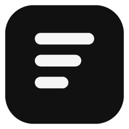<br>
  <sub>UI font: <a href="https://github.com/vercel/geist-font">Geist</a> (SIL OFL, <code>ui/fonts</code>). Icons: drawn for stash.</sub><br>
  <sub>Backdrops, both public domain: Peter Paul Rubens, <i>The Fall of Phaeton</i> (c. 1604–08, National Gallery of Art, Washington) and Francisco Bayeu, <i>Olympus: The Battle of the Giants</i> (1764, Museo del Prado).</sub>
</p>
